# Kitty Open Studio

An open-source, self-hosted AI video studio powered by **your own ComfyUI**.
Make pictures, edits, video with sound, talking characters and upscales from 33 curated open-weights workflows,
cut them on a timeline, and let Claude or ChatGPT direct a whole music video over MCP: all on your own GPU
(a Runpod pod, pay-per-second serverless, or your own card).

Built for Comfy's October 2026 open-source app challenge.

## ▶ 2-minute demo

<a href="docs/demo/kitty-open-studio-demo.mp4">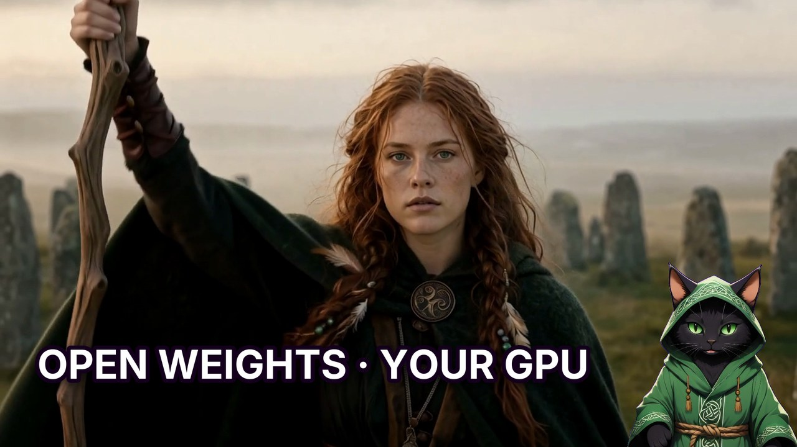</a>

▶ **[Watch the 2-minute demo](docs/demo/kitty-open-studio-demo.mp4)**: a Celtic shaman from one prompt, an edit, MiniMax H3
video with sound, an NVIDIA RTX upscale on the timeline, and Claude directing a 10-second LTX 2.5 shot over MCP.
Narrated by Druid Cat.

<p>


</p>

## The app

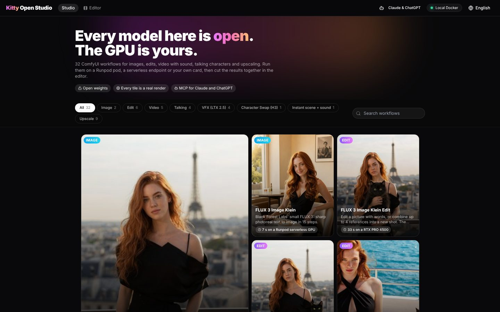

<p>
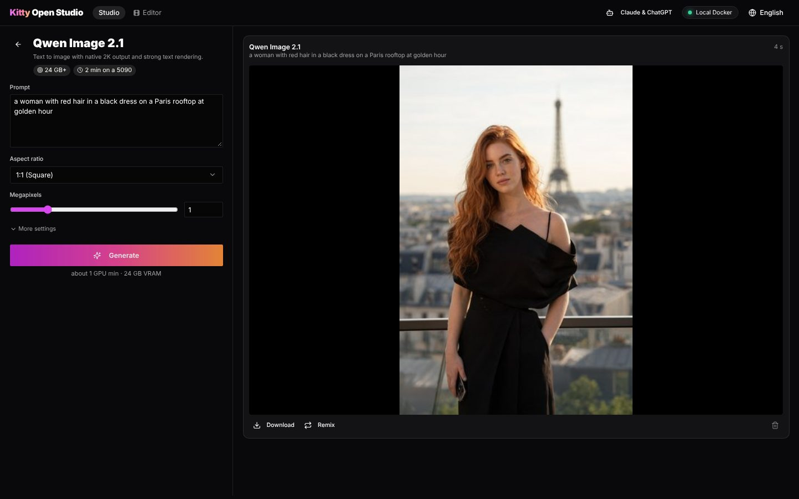
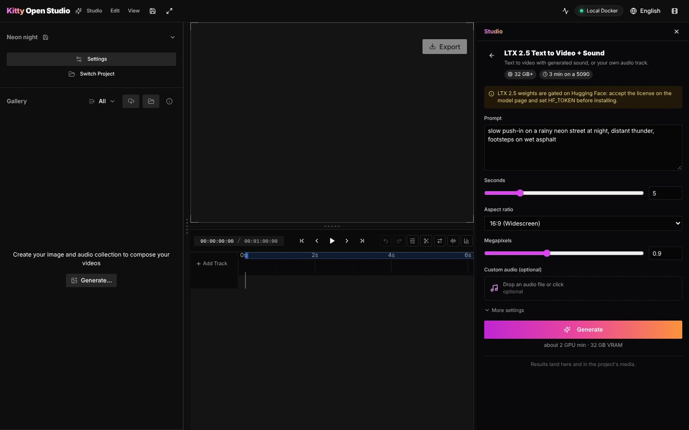
</p>
<p align="center">
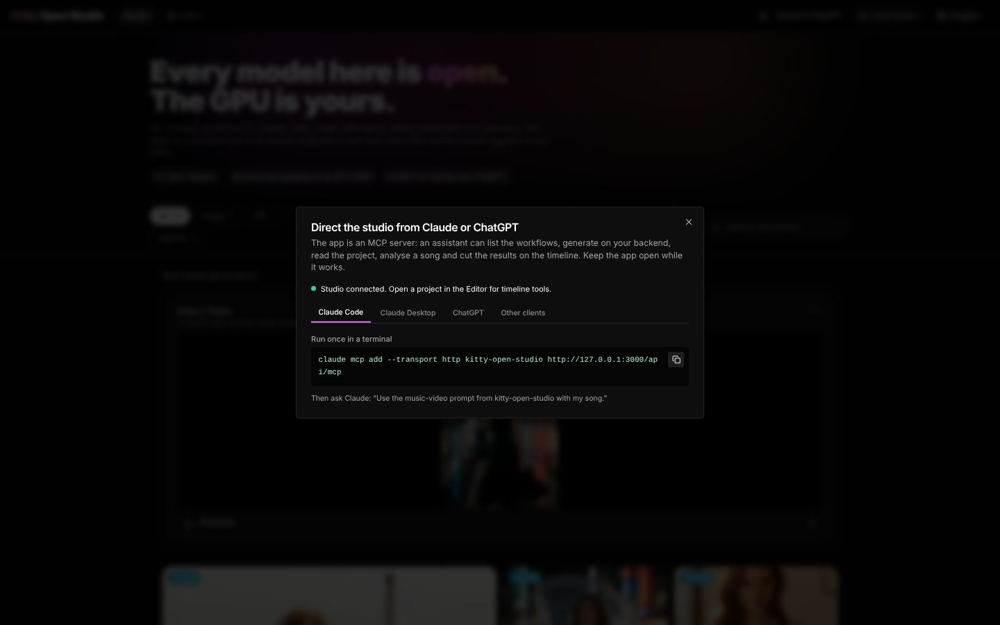
</p>

- **Studio**: every workflow is a card with a real render and its time on a Runpod GPU. Pick one, fill in the form, press
  Generate; the feed shows queue, progress, results, Remix and Download.
- **Editor**: the timeline from Kitty 1.x with the same Studio as a side panel; results land in the project's media.
  Right-click a clip to upscale, edit, animate or interpolate it with the matching card.
- **Your backend**: a Runpod pod, a serverless endpoint (pay per second) or Docker on your GPU, set in the header pill.
- **Claude and ChatGPT over MCP**: the app is an MCP server. An assistant lists the workflows, generates on your
  backend, reads the project, analyses your song with its own tools and cuts the shots on the beat
  ([docs/mcp.md](docs/mcp.md)).
- **Safe for work**: the app refuses sexual or nude prompts, from the Studio, the editor and MCP alike
  ([`app/src/lib/safety.ts`](app/src/lib/safety.ts): the MIT [obscenity](https://github.com/jo3-l/obscenity) matcher
  plus a nudity word list in several languages).

```bash
cd app && npm ci && npm run dev        # http://localhost:3000 ; desktop build: npm run electron:build (Windows) / electron:build:linux
```

## Made with Kitty Open Studio

One prompt idea (a red-haired woman in a black dress, in scenes of every kind), then edits, video, voices and upscales, all from the curated cards in this repository. Every thumbnail is a real render; the badge under it is the card and how long the job took.

### 🖼️ Pictures

<table>
<tr><td align="center" valign="top"><br><br><sub>Golden hour on a Paris rooftop</sub></td><td align="center" valign="top"><br><br><sub>Morning in a minimalist cafe</sub></td></tr>
</table>

### 🐈‍⬛ Edits: *add a black cat with green eyes*

<table>
<tr><td align="center" valign="top">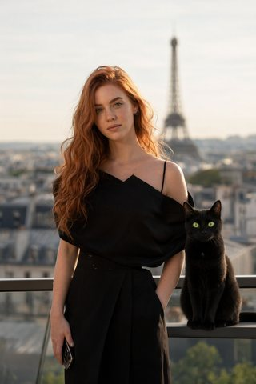<br><br><sub>+ a black cat on the railing</sub></td><td align="center" valign="top">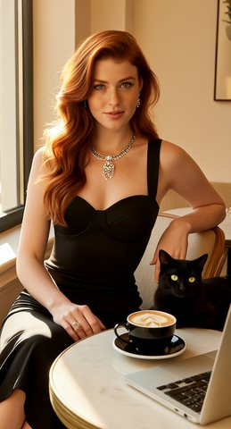<br><br><sub>+ a black cat in the cafe</sub></td><td align="center" valign="top">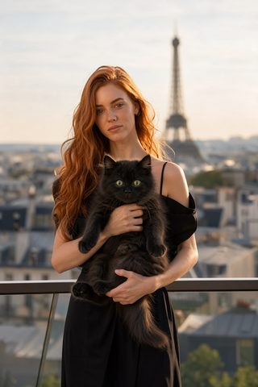<br><br><sub>+ a black cat in her arms</sub></td></tr>
<tr><td align="center" valign="top"><br><br><sub>Masked area: a cat on the deck</sub></td><td align="center" valign="top">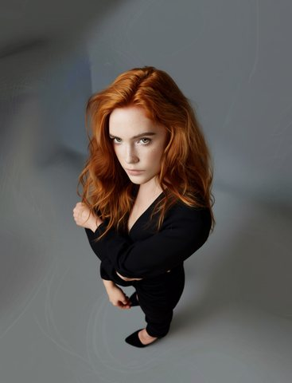<br><br><sub>New camera angle from one picture</sub></td></tr>
</table>

### 🎬 Video with sound

<table>
<tr><td align="center" valign="top"><br><br><sub>Beach promenade, sea sound</sub></td><td align="center" valign="top"><br><br><sub>The Paris picture takes a selfie</sub></td><td align="center" valign="top"><br><br><sub>From the picture to the edit: the cat jumps up</sub></td></tr>
<tr><td align="center" valign="top"><br><br><sub>768 x 1344 with stereo sound</sub></td><td align="center" valign="top"><br><br><sub>Woman + cat from two pictures</sub></td><td align="center" valign="top"><br><br><sub>Text to scene + sound, 1344 x 768</sub></td></tr>
<tr><td align="center" valign="top"><br><br><sub>"Hi everyone, welcome back to my channel"</sub></td><td align="center" valign="top"><br><br><sub>A cat walks in and sits down</sub></td><td align="center" valign="top"><br><br><sub>Sea breeze, sunglasses</sub></td></tr>
</table>

### 🗣️ Talking, character swap, motion transfer

<table>
<tr><td align="center" valign="top"><br><br><sub>A picture speaks a recorded voice</sub></td><td align="center" valign="top"><br><br><sub>The dancer becomes an anime character</sub></td><td align="center" valign="top"><br><br><sub>Same dance, the Paris woman</sub></td></tr>
<tr><td align="center" valign="top"><br><br><sub>The Paris picture talks, full frame</sub></td><td align="center" valign="top"><br><br><sub>New voice, new lip sync on the cafe clip</sub></td><td align="center" valign="top">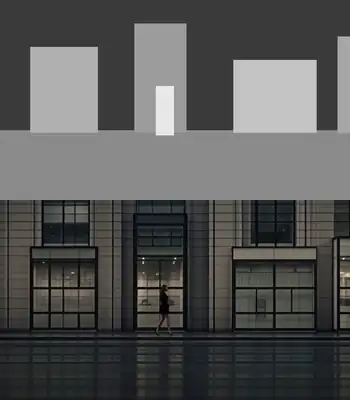<br><br><sub>Grey boxes in, a dusk street out</sub></td></tr>
<tr><td align="center" valign="top"><br><br><sub>The yacht picture dances the FastH3 moves</sub></td><td align="center" valign="top">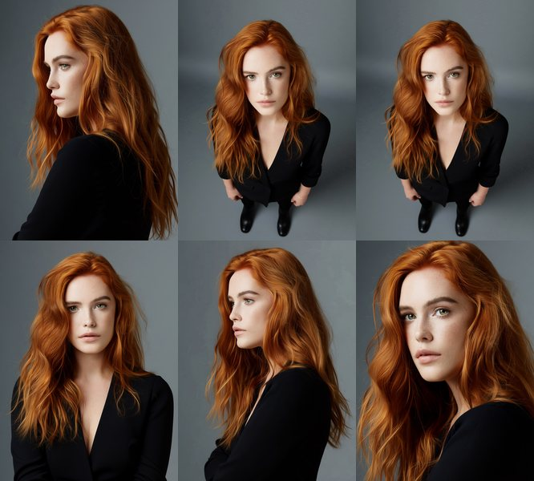<br><br><sub>Six shots from one portrait</sub></td></tr>
</table>

### 🔍 Upscale and restore

<table>
<tr><td align="center" valign="top"> 1664 x 2496"><br><br><sub>832 x 1248 -> 1664 x 2496</sub></td><td align="center" valign="top"> 2730 x 4096"><br><br><sub>832 x 1248 -> 2730 x 4096</sub></td><td align="center" valign="top"> 1080 x 1920"><br><br><sub>720 x 1280 -> 1080 x 1920</sub></td></tr>
<tr><td align="center" valign="top">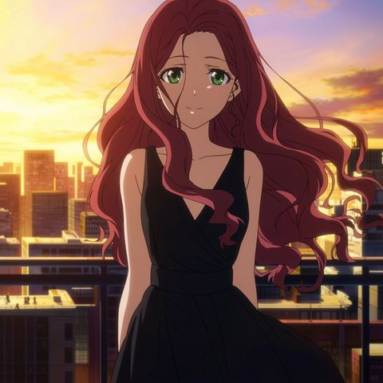 2048, anime"><br><br><sub>1024 -> 2048, anime</sub></td><td align="center" valign="top">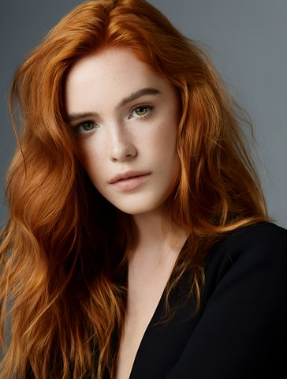 2112 x 2784"><br><br><sub>1056 x 1392 -> 2112 x 2784</sub></td><td align="center" valign="top"> 2688 x 1536, 5 s clip"><br><br><sub>1344 x 768 -> 2688 x 1536, 5 s clip</sub></td></tr>
<tr><td align="center" valign="top">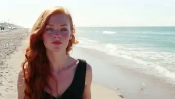 1920 x 1088"><br><br><sub>1280 x 704 -> 1920 x 1088</sub></td><td align="center" valign="top"> 1080 x 1890"><br><br><sub>768 x 1344 -> 1080 x 1890</sub></td><td align="center" valign="top"><br><br><sub>Detail restore at 1344 x 768</sub></td></tr>
<tr><td align="center" valign="top"> 50 fps"><br><br><sub>30 -> 50 fps</sub></td></tr>
</table>

## Quick start

1. **A GPU backend.** Deploy the [Kitty Open Studio template on Runpod](https://console.runpod.io/hub/template/taeuyhy7no?ref=1yinrvfx)
   with a network volume and pick a model preset on port 7861, or `docker compose up` in `backend/docker` on your own
   NVIDIA card, or just ask your AI assistant to do it (below).
2. **The app.** `cd app && npm ci && npm run dev` (web, http://localhost:3000) or `npm run electron:dev` (desktop).
   On first start it shows what it makes, then points at the backend pill: paste the pod id, a serverless endpoint
   or the local URL.
3. **Create.** Pick a card in the Studio, or open the Editor and let Claude or ChatGPT direct
   ([docs/mcp.md](docs/mcp.md)).

## Open weights

Every generation runs on open-weights models in your own ComfyUI: no partner nodes, no closed generation APIs, and
the weights download straight from their publishers ([licenses](docs/models.md)). Two Upscale cards use NVIDIA's
free but closed RTX Video SDK; the **100% open weights** profile (backend setting or `KITTY_PROFILE=open-weights`)
hides them and swaps RTX Video Super Resolution for an open resize. Claude and ChatGPT are optional MCP clients that
direct the app; nothing they do is needed to generate.

## Layout
- [`app/`](app/) - the desktop and web app (Electron + Next.js + TypeScript): Studio cards, generation feed, timeline editor, MCP server.
- [`backend/`](backend/) - curated ComfyUI workflows, model manifest, model installer, a small Docker image (ComfyUI, its venv and the models live on your volume) and Runpod job handler.
- [`docs/`](docs/) - [Deploy on Runpod](docs/runpod.md) · [Docker image](docs/docker.md) · [S3 outputs](docs/s3.md) · [AI-assisted setup](docs/ai-assisted-setup.md) · [MCP for Claude and ChatGPT](docs/mcp.md) · [Hosted demo link](docs/hosted-demo.md) · [Workflows](docs/workflows.md) · [Models and licenses](docs/models.md) · [Third-party software](THIRD_PARTY.md)

## Let your AI assistant set it up

Open this repository in Claude Code (or Codex, Cursor's agent, ...) and say *"set up Kitty Open Studio for me"*.
It follows [AGENTS.md](AGENTS.md): asks what you want to make, shows the download size, the GPU price per hour and
the storage cost per month, and after your yes creates the Runpod volume and pod (or uses your own GPU), installs
the models and checks that the workflows are ready. Your keys stay in a local `.env` file, never in the chat.

## Where it runs

- **[Runpod](https://runpod.io?ref=1yinrvfx)** (built and tested there): a pod with a network volume, then optionally a serverless endpoint on the same
  volume that bills per second. Deploy the **[public Kitty Open Studio template](https://console.runpod.io/hub/template/taeuyhy7no?ref=1yinrvfx)** or let your AI
  assistant create everything ([docs/runpod.md](docs/runpod.md)).
- **Your own NVIDIA GPU**: `docker compose up` ([docs/docker.md](docs/docker.md)).
- **Anywhere else with Docker and a GPU** (Vast.ai, your own server, ...): the same public image, or build and push
  your own; an open option we do not test ([docs/docker.md → Other GPU clouds](docs/docker.md#other-gpu-clouds-open-option-not-tested)).

## Backend in one minute
```bash
python backend/installer/cli.py --estimate --preset starter          # size + monthly storage cost
python backend/installer/cli.py --preset starter --models-dir /path/to/ComfyUI/models
cd backend/docker && docker compose up                               # ComfyUI :3020, installer :7861
```

## License
MIT (see [LICENSE](LICENSE)). Models keep their own licenses ([list](docs/models.md)) and are downloaded by the user.
